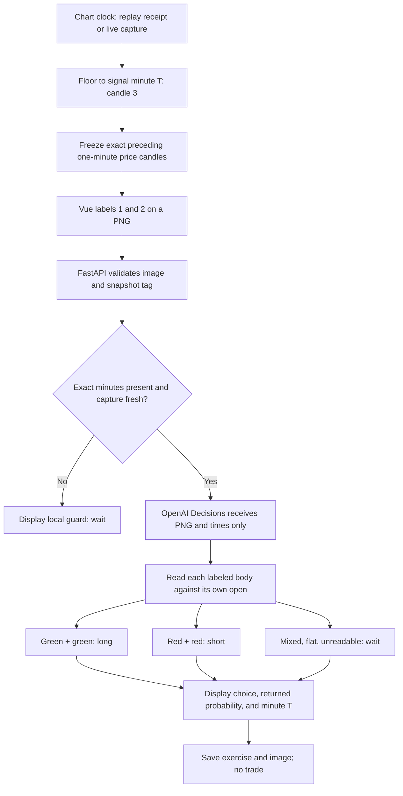

# Decision API chart-reading exercise

Open the live chart or Replay, select **1 minute**, and click **Ask about chart** beside the candle inspector. The chart and inspector appear above the automation, indicator controls, and feed summary. The inspected historical candle does not set the signal minute: the displayed chart clock does.

Clicking **Ask about chart** scrolls to the Decision API heading and moves keyboard focus there. Progress, errors, and results appear directly below the heading, above the flowchart and captured image.

For replay, the clock is the saved observation's receipt time, matching replay's information cutoff. For live, FastAPI freezes its UTC capture clock when preparing the snapshot. The clock is floored to the minute, T. Candle 1 must start at T−2 minutes and candle 2 at T−1 minute. No substitution across missing minutes is allowed. A live capture that crosses into another minute before submission returns a local stale/wait guard and should be recaptured.

The screenshot contains only the two target minutes, using the same regular-session candles as the workstation. The image shows a flat body in gray and leaves out the horizontal price guide so it cannot be mistaken for a candle body. The model receives the PNG and timestamps. Green and red refer to each candle’s own close versus open, even if the second green candle is below the first one.

`POST /api/chart-exercise/snapshots` prepares the local snapshot. `POST /api/chart-exercise` validates its tagged PNG, calls OpenAI's `POST /v1/decisions`, and records the image/result in SQLite `chart_exercises`. This independent exercise has no simulator execution path. Existing `/api/decisions` analyst/reviewer calls remain for paper automation. The manual exercise does not enable or stop that separately controlled automation.

The displayed probability comes from the returned `probabilities` entry for the selected choice; missing probability is **Not available**. Confidence is not substituted for choice probability. Provider failures and malformed replies display their status rather than inventing a choice. Local stale/wait guards are labeled separately from model choices.

The backend needs `OPENAI_API_KEY` in its process environment. The root `.env` is not automatically loaded. [OpenAI Decisions guide](https://developers.openai.com/api/docs/guides/decisions) and [response schema](https://developers.openai.com/api/reference/resources/decisions/methods/create) describe image inputs and choice probabilities.

Run `python -m scripts.exercise_smoke` for the repeatable offline browser SmokeTest. It starts FastAPI and Vue with an isolated database, opens installed Edge/Chromium, plays saved green/red/mixed/flat/missing-minute charts, clicks the control, checks visible results, validates the model-boundary payload and saved PNGs, and confirms no paper orders/fills. It also checks provider errors, malformed replies, absent probability, and an expired live minute. External model replies are controlled; this verifies the application flow, not a live model's visual accuracy. The runner closes its browser and services on success or failure.

Run `python -m scripts.exercise_smoke --live` with `OPENAI_API_KEY` in the process environment to verify the three constructed replay pairs with OpenAI. This mode sends three synthetic PNGs and checks for long, short, and wait respectively. The disposable SQLite database records the returned choices and probabilities for the check.

These example captures target 2026-11-09 14:32 UTC using the 14:30 and 14:31 candles. [Green pair](screenshots/chart-exercise/GREEN.png) · [Red pair](screenshots/chart-exercise/RED.png) · [Mixed pair](screenshots/chart-exercise/MIX.png).
